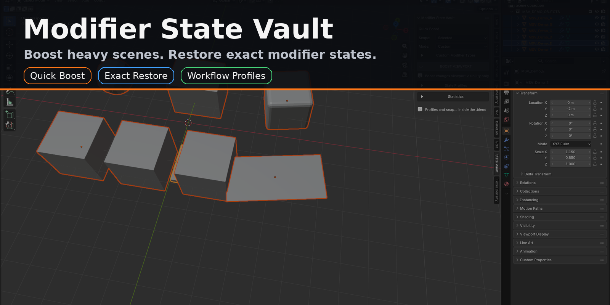
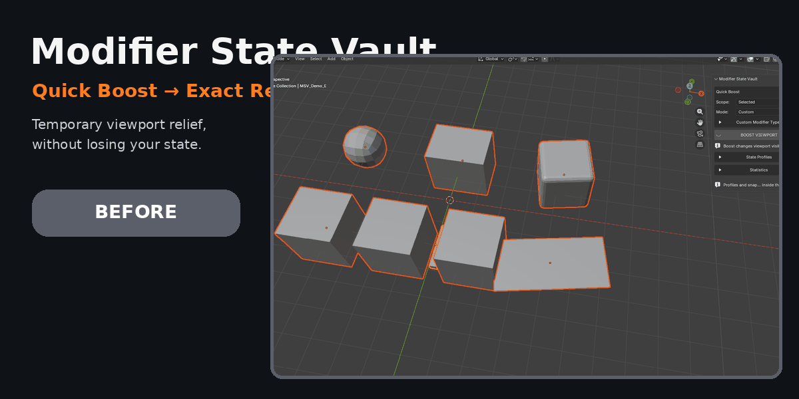
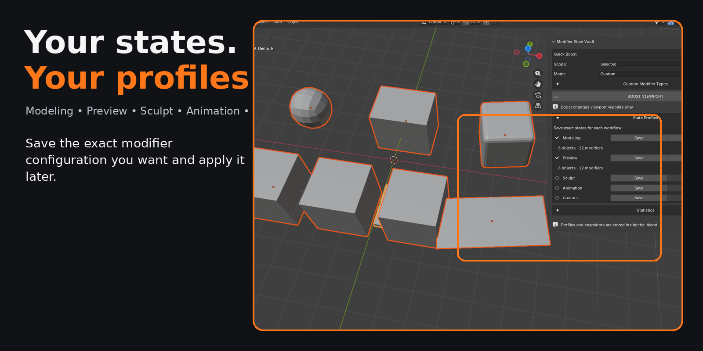
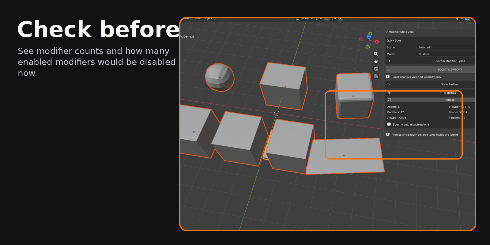

# Modifier State Vault — Product Showcase

> **Public showcase repository.** The customer release archive and development repository are not hosted here. This repository contains product documentation, media, and release evidence for portfolio/review purposes.

**Modifier State Vault** is a focused Blender workflow add-on for temporarily reducing viewport modifier load without losing the exact mixed state of a modifier stack.

## Core workflow

1. Choose a scope.
2. Choose a Boost mode.
3. Run **BOOST VIEWPORT**.
4. Work with the lighter viewport state.
5. Run **RESTORE EXACT STATES**.

Quick Boost changes viewport visibility only and preserves a protected snapshot for exact restoration.

## Features

### Quick Boost
- Selected
- Visible
- Active Collection
- Whole Scene

### Boost modes
- Safe
- Strong
- All
- Custom

### Workflow profiles
Five user-defined state slots:
- Modeling
- Preview
- Sculpt
- Animation
- Custom

Profiles store exact workflow states including viewport, render, edit-mode, cage and expanded/collapsed modifier UI state.

### Statistics
On-demand statistics show:
- objects with modifiers
- total modifiers
- viewport ON / OFF
- render OFF
- targeted modifiers
- **Boost would disable now**

## Reliability

Release testing includes:
- **18/18** functional checks
- **17/17** stress checks
- **54/54** master regression checks
- manual UI smoke testing
- save → full Blender shutdown → reopen → exact profile restore
- rename/reorder recovery
- deleted object/modifier safety
- Blender Extension validation

See [Release Testing](docs/RELEASE_TESTING.md).

## Privacy

Modifier State Vault:
- makes no network requests
- collects no telemetry
- requires no account
- requires no external Python packages
- stores profile/snapshot state inside the `.blend`

## Compatibility

- Blender Extension format
- Manifest minimum: Blender 4.2
- Full release validation/runtime testing completed on Blender 5.0
- License: GPL-3.0-or-later

## Documentation

- [Installation and Quick Start](docs/INSTALLATION.md)
- [FAQ](docs/FAQ.md)
- [Release Testing](docs/RELEASE_TESTING.md)
- [Source and Distribution Notes](SOURCE_AND_DISTRIBUTION.md)

## Distribution

Marketplace submission is in preparation.

The marketplace-distributed extension package contains the GPL-licensed Python source required by the add-on. This public repository is intentionally maintained as a showcase rather than a mirror of the customer release archive.
